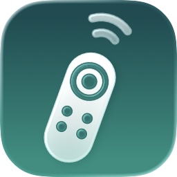
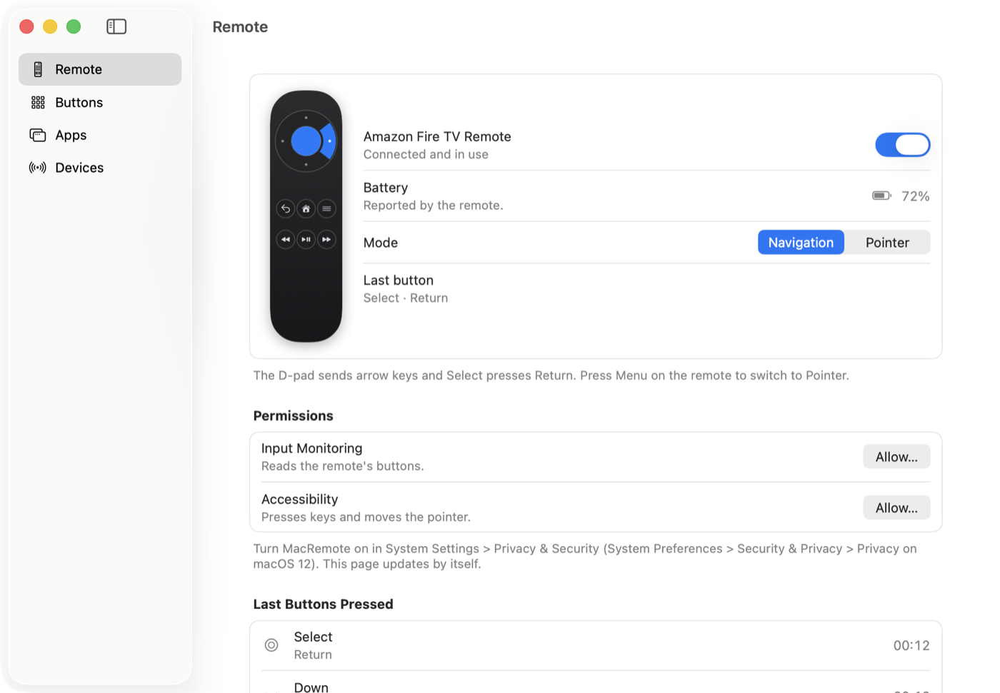
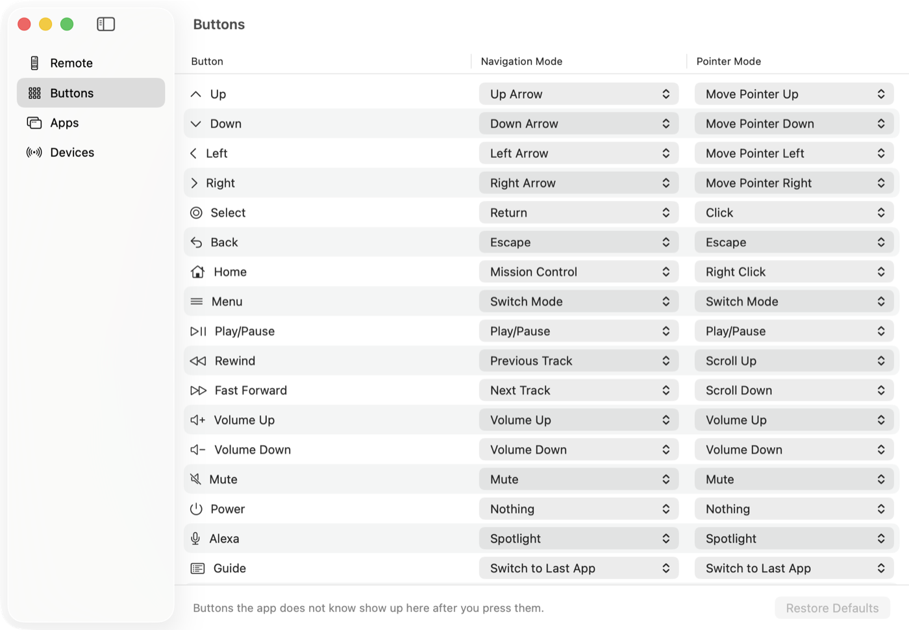
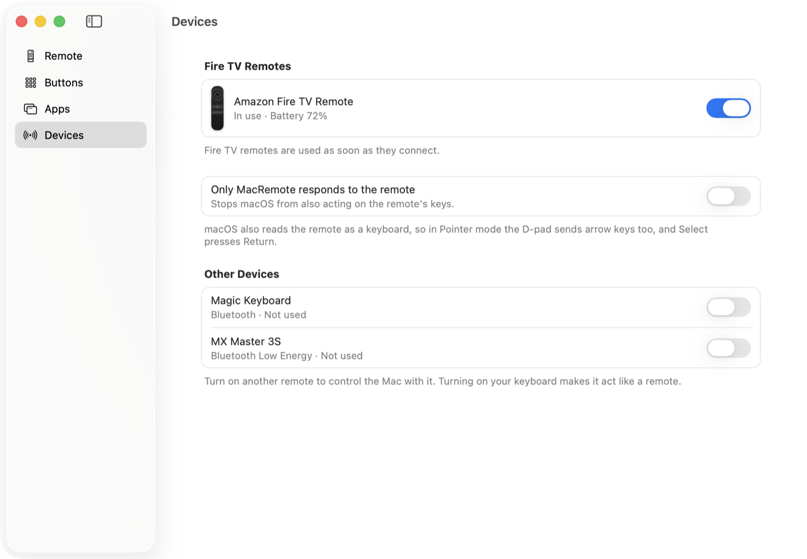
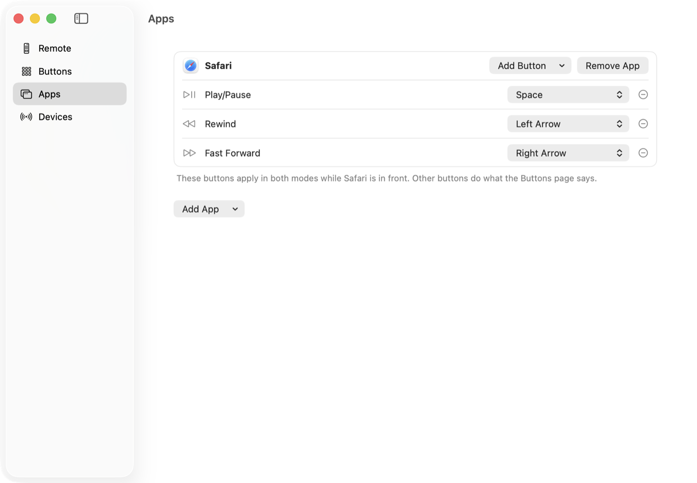
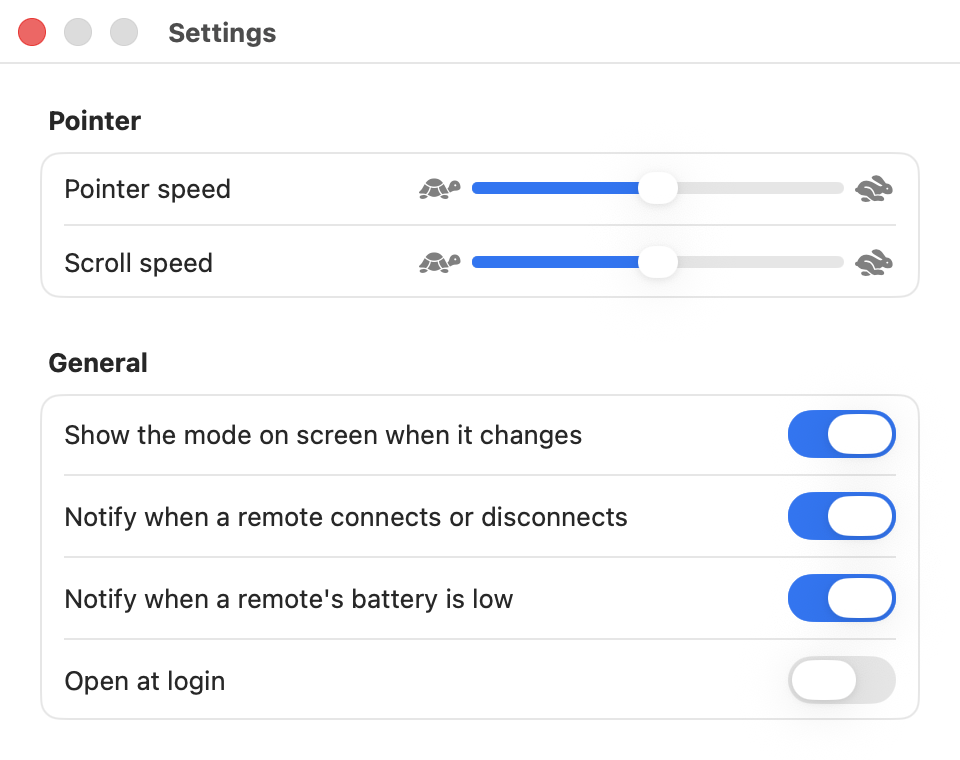

<p align="center">
  <picture>
    <source media="(prefers-color-scheme: dark)" srcset="docs/images/icon-dark.png">
    
  </picture>
</p>

<h1 align="center">MacRemote</h1>

<p align="center">
  <strong>Turn a Fire TV remote into a remote for your Mac.</strong><br>
  Move through menus, play and pause, change the volume, and even drive the pointer from the couch.
</p>

<p align="center">
  
  
  
  
</p>

<p align="center">
  <picture>
    <source media="(prefers-color-scheme: dark)" srcset="docs/images/remote-dark.png">
    
  </picture>
</p>

---

## Why

Amazon's Fire TV remotes (the Alexa Voice Remote family) are cheap, comfortable,
and pair with a Mac over Bluetooth. Out of the box, macOS only understands a few
of their keys. MacRemote reads every button and turns it into something useful:
arrow keys for a media app, Spotlight on the Alexa button, Mission Control on
Home, or a full pointer with click, right click, drag, and scroll.

It is a small native app that lives in its window and the menu bar. There's no
account, no network, and nothing to set up beyond two macOS permissions.

## Features

- **Two modes, one button apart.** Press **Menu** on the remote to switch between
  them. A small on-screen badge shows which one you're in.
  - **Navigation**: the D-pad sends arrow keys and Select presses Return. Use it
    for menus, lists, sidebars, and players.
  - **Pointer**: the D-pad moves the pointer and Select clicks. Hold Select while
    moving to drag, and use Rewind and Fast Forward to scroll.
- **Pointer that feels right.** It starts slow so you can aim, then speeds up to
  cross the screen. Pointer and scroll speed are set in Settings.
- **Change what every button does.** Each button gets its own action in each mode,
  picked from nearly 40: keys, app and window switching, clicks and scrolling,
  media and volume, brightness, Mission Control, Spotlight, and display sleep.
- **Buttons per app.** On the Apps page, a button can do something else while a
  chosen app is in front. A new app starts with Play/Pause sending Space, for
  video players that ignore the Mac's media keys.
- **Learns new buttons.** Press a button MacRemote doesn't know and it appears on
  the Buttons page, ready to set.
- **Watch it work.** The picture of the remote lights up as you press buttons, and
  the last presses are listed with what each one did.
- **Keeps macOS out of the way.** Fire TV remotes also act as keyboards. One switch
  makes only MacRemote respond to them, so a press never acts twice. Play/Pause
  never opens Music by itself, and the Mac's own keyboard is never affected.
- **Battery and notifications.** The remote's battery level shows on the Remote
  page, in Devices, and in the menu bar. MacRemote can notify you when a remote
  connects or disconnects, and when its battery is low.
- **Other devices work too.** Turn on any other connected HID device and it
  acts like a remote.
- **A real Mac app.** Light and dark mode, a menu bar item, a keyboard shortcut for
  every action, and an option to open at login.

## A look around

<table>
  <tr>
    <td width="50%">
      <picture>
        <source media="(prefers-color-scheme: dark)" srcset="docs/images/buttons-dark.png">
        
      </picture>
      <p align="center"><b>Buttons</b>: pick what each button does in each mode.</p>
    </td>
    <td width="50%">
      <picture>
        <source media="(prefers-color-scheme: dark)" srcset="docs/images/devices-dark.png">
        
      </picture>
      <p align="center"><b>Devices</b>: choose which remotes and devices to use.</p>
    </td>
  </tr>
  <tr>
    <td width="50%">
      <picture>
        <source media="(prefers-color-scheme: dark)" srcset="docs/images/apps-dark.png">
        
      </picture>
      <p align="center"><b>Apps</b>: give an app its own buttons.</p>
    </td>
    <td width="50%"></td>
  </tr>
</table>

<p align="center">
  <picture>
    <source media="(prefers-color-scheme: dark)" srcset="docs/images/settings-dark.png">
    
  </picture>
  <br>
  <b>Settings</b>: pointer and scroll speed, the mode badge, notifications, and open at login.
</p>

## What the buttons do at first

| Button | Navigation mode | Pointer mode |
|---|---|---|
| D-pad | Arrow keys | Move the pointer |
| Select | Return | Click (hold to drag) |
| Back | Escape | Escape |
| Home | Mission Control | Right click |
| Menu | Switch mode | Switch mode |
| Rewind / Fast Forward | Previous / next track | Scroll up / down |
| Play/Pause | Play/Pause | Play/Pause |
| Volume and Mute | Volume and Mute | Volume and Mute |
| Alexa | Spotlight | Spotlight |
| Guide | Switch to last app | Switch to last app |

You can change any of these on the Buttons page. **Restore Defaults** (⇧⌘R)
brings them back. To change a button in one app only, use the Apps page.

## Keyboard shortcuts

| Action | Shortcut |
|---|---|
| Pause or resume the remote | ⇧⌘P |
| Switch mode | ⇧⌘M |
| Restore default buttons | ⇧⌘R |
| Add an app with its own buttons | ⇧⌘A |
| Remote, Buttons, Apps, Devices page | ⌘1, ⌘2, ⌘3, ⌘4 |
| Settings | ⌘, |

These actions are also in the **Remote** menu and the menu bar item.

## Get started

1. Get a zip made with [`tools/release.sh`](#make-a-copy-for-other-macs), or [build it yourself](#build-from-source).
2. Unzip it and drag **MacRemote** into **Applications**.
3. Open it. If macOS says it can't verify the app, click **Done**, then open
   **System Settings > Privacy & Security** (on macOS 12: **System Preferences >
   Security & Privacy > General**) and click **Open Anyway** next to MacRemote.
   Confirm with your password. You only do this once.
4. In MacRemote, click **Allow…** for **Input Monitoring** and **Accessibility**,
   and switch MacRemote on in both lists. The page updates by itself.
5. Pair the remote. Unplug the Fire TV it was paired with, hold **Home** on the
   remote for about 10 seconds until the light blinks, then click **Connect** in
   Bluetooth settings. If the Keyboard Setup Assistant opens, close it.

That's it. Press **Menu** to try both modes.

### Why the permissions

| Permission | What MacRemote uses it for |
|---|---|
| Input Monitoring | Reading the remote's buttons |
| Accessibility | Pressing keys, moving the pointer, and clicking, and stopping macOS from also acting on the remote |

Permissions stay granted as long as you keep the same copy. Installing a new
ad hoc build means granting them again: remove the old MacRemote entries with
**–** first.

## How it works

```
 Fire TV remote ──Bluetooth──▶ HIDMonitor ──(usage page, usage, pressed)──▶ RemoteEngine ──▶ EventSynth ──▶ macOS
                               IOHIDManager                                 Profile lookup     CGEvents
                                                                            for current mode
```

- **`HIDMonitor`** finds HID devices with IOHIDManager and opens Fire TV remotes
  (vendor `0x1949`, or by name), exclusively when macOS allows it.
- **`RemoteEngine`** looks up each press in the front app's own buttons, then in
  the profile for the current mode, and runs the action once, repeats it while held, or keeps the pointer moving with
  acceleration.
- **`EventSynth`** posts the keyboard, mouse, scroll, and media events.
- **`RemoteKeyFilter`** is an event tap that drops the keys and media keys macOS
  makes from a remote it shares with MacRemote. That matters on macOS 12, where
  the `hidutil` key block doesn't stop them.
- **`MacRemoteKit`** holds the rules (buttons, actions, profiles, app overrides, pointer motion, battery)
  with no UI, and is covered by unit tests.

## Build from source

You need Xcode 26 or later (Swift 6.2) on macOS. There's no Xcode project: it's a
Swift package with build scripts.

```bash
./build.sh            # build, sign, and install /Applications/MacRemote.app
./build.sh --open     # same, then restart the app
```

Checks:

```bash
swift test --scratch-path ~/Library/Developer/MacRemote/test-build   # unit tests
tools/selftest.sh                                                    # drives the real engine with simulated presses
tools/snap.sh                                                        # light and dark snapshots of every page
tools/grid-lint.sh                                                   # layout grid check
```

The app targets macOS 12, so the compiler rejects anything newer. Newer features
such as Liquid Glass and the login item API are used only where available, with a
fallback on older systems.

### Make a copy for other Macs

```bash
tools/release.sh
```

It writes a universal `dist/MacRemote-<version>.zip`. Copy it to the other Mac by
AirDrop, USB drive, or a shared folder. How smoothly it opens there depends on how
it was signed (the script uses the best signing it finds):

| Signed with | First open on another Mac |
|---|---|
| Developer ID + notarized | Opens with no warning |
| Developer ID, not notarized | Blocked once, then Open Anyway |
| Ad hoc (no certificate, the default here) | Blocked once, then Open Anyway |

To notarize you need the Apple Developer Program (paid). Once you have a
"Developer ID Application" certificate in the keychain:

```bash
xcrun notarytool store-credentials macremote --apple-id <you@example.com> --team-id <TEAMID>
NOTARY_PROFILE=macremote tools/release.sh
```

## Project layout

| Path | What's there |
|---|---|
| `Sources/MacRemote/` | The app: AppKit shell, SwiftUI pages, remote input and output |
| `Sources/MacRemoteKit/` | Buttons, actions, profiles, app overrides, pointer motion, and battery, with no UI |
| `Tests/MacRemoteKitTests/` | Unit tests |
| `Icon/AppIcon.icon` | The Icon Composer app icon |
| `tools/` | Release, self-test, snapshot, icon, and grid scripts |
